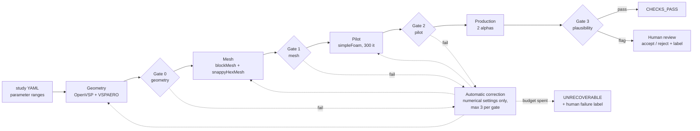
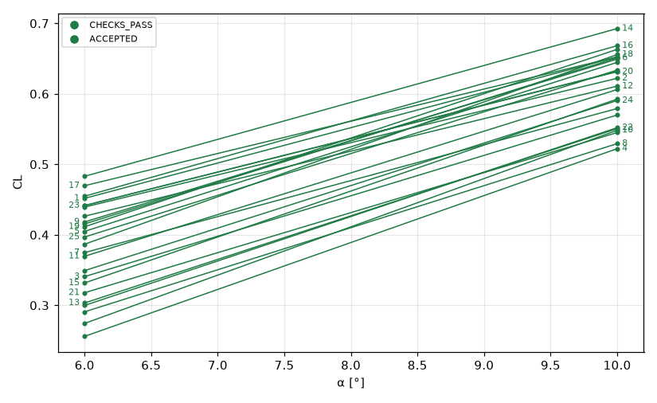
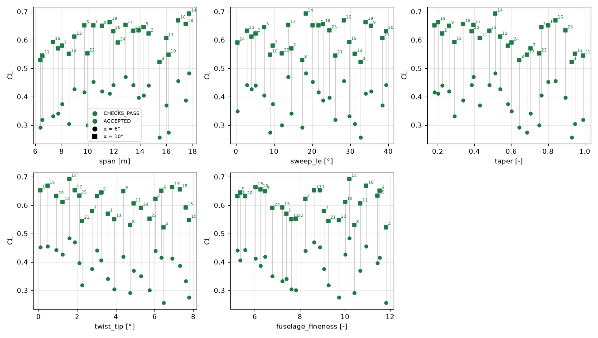
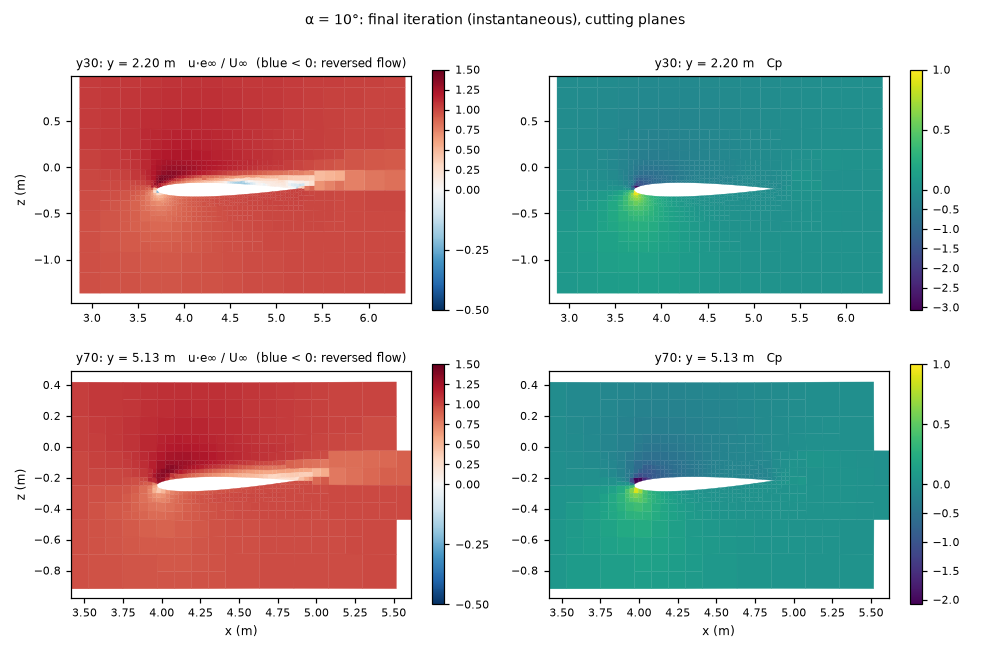

# aero-pipeline

An automated, self-checking CFD pipeline: **OpenVSP geometry → OpenFOAM mesh and solution → checks → human
review**. You give it a range of wing–fuselage designs; it builds each one, meshes it, runs a pilot and a
production simulation, fixes numerical problems on its own where it is allowed to, and stops at a human for
anything that touches physics.

> **Authorship.** I used [Claude Code](https://claude.com/claude-code) (Anthropic's AI coding agent) to write
> the code and build this pipeline. The problem, the architecture design and the human review loop are mine
> alone. Every physics and threshold decision is recorded in [`decisions.md`](decisions.md) with who made it.

## The problem

Running many CFD cases by hand is slow, and running them blindly is dangerous: a bad mesh or an unconverged
solution still produces a number. The question was whether the whole chain (geometry, mesh, solver, checks,
corrections) can run unattended, while every judgement about physics stays with a human.

## Architecture



- **One directory per run** (`runs/<study>/<run>/`: geometry, mesh, case, report, frozen config, corrections log)
  and one **SQLite database** (`runs/runs.db`) as the single source of truth. Every number in a report is read
  from it.
- **Corrections** change numerical settings only (mesh refinement, snapping, smoothing, iterations,
  correctors). Physics (model, boundary conditions, freestream, alpha, viscosity) is never changed
  automatically. Every correction is logged.
- **OpenFOAM v2412 runs in its pinned container** (rootless Podman), one container per stage. Cases run in
  parallel, one core each.
- Every stage is resumable: stopping and rerunning `aero run <study>` continues where it left off.

### Gates (thresholds in [`configs/gates.yaml`](configs/gates.yaml))

| Gate | Checks | On failure |
|---|---|---|
| 0 Geometry | closed surface, no illegal triangles, ≥ 12 cells across the tip chord | correction or UNRECOVERABLE |
| 1 Mesh | non-orthogonality ≤ 70°, skewness ≤ 4, no negative volumes, 50k–1M cells, wetted area ≥ 98 % of the STL | correction or UNRECOVERABLE |
| 2 Pilot | residuals drop ≥ 2 orders, CL change ≤ 5 % over the last 100 iterations, coefficients bounded (abs ≤ 2) | correction or UNRECOVERABLE |
| 3 Plausibility | CL steady (std ≤ 1e-3), CL within 25 % of VSPAERO, CL–α slope 3–6 /rad, mass balance, CD ≥ 0 | **FLAGGED → human** |

Gates decide on numbers only, never on images.

### Human review loop

A run that fails Gate 3 is never accepted or rejected by the pipeline. It waits in a queue, worst first:

```
aero review list batch                     # flagged runs, most severe first
aero review open batch-0002                # its report: results, convergence, cutting planes
aero review decide batch-0002 --accept --label ok_false_alarm --note "..."
aero review label <run> --label mesher_limitation   # why a run could not be completed
```

Labels come from a fixed vocabulary ([`configs/review.yaml`](configs/review.yaml)). The reviewer judges, for
example, whether a separated or oscillating solution is an acceptable steady approximation, from the
cutting-plane contours and the CL history in the report.

## Results

**Validation (Phase 7).** Three-grid mesh study (Celik et al. 2008 GCI): the CL–α slope converges with a GCI of
1 % on the chosen medium mesh (~190k cells per half model); Richardson-extrapolated slope 4.60 /rad against
Helmbold lifting-line theory 4.57 /rad. Over the baseline study, CFD/Helmbold = 0.999.

**Batch (Phase 8).** 25 designs (span 6–18 m, sweep 0–40°, taper 0.15–1, washout 0–8°, fuselage fineness 5–12),
α = 6° and 10°, one command, 4 h 08 min on a 6-core laptop, no manual step until review:

| Step | Passed |
|---|---|
| Geometry, mesh, pilot, production | 25 / 25 (1 run recovered by an automatic correction) |
| Gate 3 | 13 passed, 12 flagged |
| Human review | 12 accepted, label `ok_false_alarm` |





Numbers on the plots are run numbers; green = passed, orange = flagged. 10 of the 12 flagged runs have a CL that
keeps oscillating at 10°: the flow is starting to separate and is really unsteady, which a steady solver can only
approximate. The reviewer accepted them as approximations because none showed a large separation bubble
(below: a small trailing-edge bubble at 30 % semi-span that is gone at 70 %).



Each study also gets a summary page (`aero summary <study>`) and a report per run, as self-contained HTML.

## Run it

Requirements: Linux x86-64, rootless **Podman**, the OpenFOAM image
`docker.io/opencfd/openfoam-default:2412`, and the **OpenVSP 3.57.0** `.deb` for Ubuntu 26.04 from
[openvsp.org](https://openvsp.org) placed in `vendor/` (not redistributed here).

```
podman pull docker.io/opencfd/openfoam-default:2412
make image            # Python side: Ubuntu 26.04 + OpenVSP + Python deps
make doctor           # checks engine, images, OpenVSP
make demo-baseline    # 10 designs, narrow ranges, α 0°/4°: every run should pass (~1 h)
make demo-batch       # 10 designs, wide ranges, α 6°/10°: some runs flagged for your review (~1.5–2 h)
make test             # unit tests (no CFD)
```

Results land in `runs/<study>/summary.html`. The image only contains the Python side; it drives the host's Podman
through its socket, so OpenFOAM runs in its own pinned image exactly as without the wrapper.

## Limitations (v1)

- **Inviscid, steady.** Laminar `simpleFoam` with a tiny viscosity and slip walls: no boundary layer, no
  friction drag (CD is numerical), no stall prediction. Separation at higher alpha comes from the sharp leading
  edge, and an oscillating solution is a sign the case is unsteady.
- Half model, two alphas per design, wing–fuselage only (no tail).
- Reviews of oscillating runs are provisional: they judge whether the steady result is an acceptable
  approximation, not what the real flow does.

## Next steps

- **Viscous and/or unsteady physics** (boundary layers, a turbulence model, transient solver), so that flags mean
  what they say.
- **ML layer** (deferred on purpose): a classifier of which designs will fail or be flagged, and a surrogate for
  CL/CD. It needs physically correct flags and human labels first, otherwise it learns the limits of v1.
- Optional: early stop for solves that clearly will not converge, a live dashboard, many-alpha studies.

## Repository

| Path | What |
|---|---|
| `src/aero/` | pipeline (`cli.py`, `runner.py`, `geom/`, `foam/`, `gates/`, `review/`, `report/`, `validation.py`) |
| `templates/` | OpenFOAM case files and report pages (Jinja) |
| `configs/` | studies, gate thresholds, correction rules, review labels |
| `notebooks/validation.ipynb` | mesh convergence and CL–α validation (Phase 7) |
| `PLAN.md`, `PHASE_REPORT.md`, `decisions.md` | the plan, what each phase delivered, every decision and who made it |

## License

MIT (see [`LICENSE`](LICENSE)) for the code in this repository. OpenVSP (NASA Open Source Agreement) and
OpenFOAM (GPL) are not included; they are used as external tools under their own licences.
